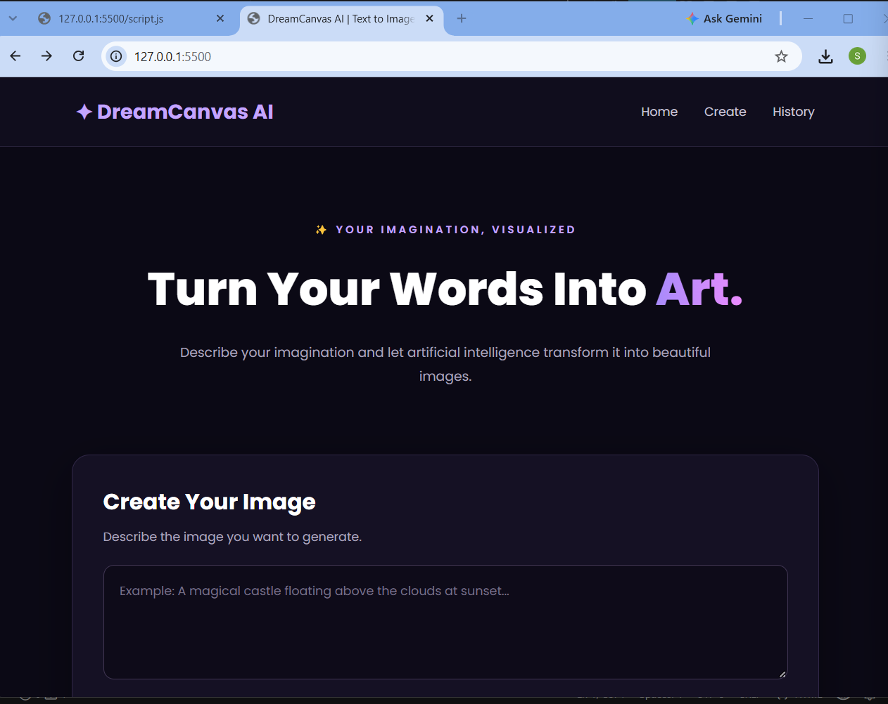
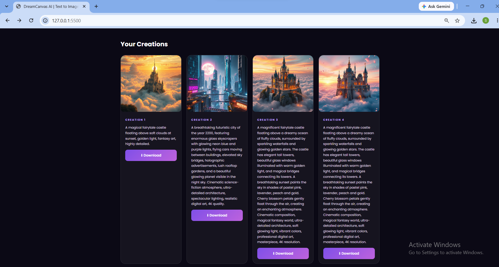

# 🎨 DreamCanvas AI – Text-to-Image Generator

DreamCanvas AI is an AI-powered web application that transforms text descriptions into beautiful images using Artificial Intelligence.

Users can enter a text prompt, generate AI artwork, download their creations, and view their previously generated images in a history gallery.

## ✨ Features

* **AI Image Generation:** Generate images from text prompts.
* **User-Friendly Interface:** Modern and responsive web interface.
* **Image Downloads:** Download generated images to your device.
* **Image History:** View previously generated images.
* **Database Storage:** Store image details using SQLite.
* **Persistent History:** Previously generated images remain available after restarting the backend.
* **Character Counter:** Track the prompt length.
* **Gallery Interface:** View creations in individual cards.
## 📸 Project Screenshots

### Home Page


### AI Generated Image


### Image History Gallery

## 🛠️ Technologies Used

### Frontend

* HTML5
* CSS3
* JavaScript

### Backend

* Python
* Flask
* Flask-CORS

### Artificial Intelligence

* Hugging Face Inference Providers
* FLUX.1-schnell

### Database

* SQLite

### Development Tools

* Visual Studio Code
* Git
* Python Virtual Environment

## 📁 Project Structure

```text
AI_Text_to_Image/
│
├── backend/
│   ├── __init__.py
│   ├── app.py
│   ├── config.py
│   ├── database.py
│   └── image_generator.py
│
├── database/
│   └── images.db
│
├── docs/
│
├── frontend/
│   ├── index.html
│   ├── style.css
│   └── script.js
│
├── generated_images/
│
├── tests/
│   ├── test_app.py
│   └── test_database.py
│
├── .env
├── .gitignore
├── requirements.txt
└── README.md
```

## ⚙️ Installation and Setup

### 1. Clone the Repository

```bash
git clone YOUR_GITHUB_REPOSITORY_URL
cd AI_Text_to_Image
```

### 2. Create a Virtual Environment

```bash
python -m venv .venv
```

### 3. Activate the Virtual Environment

Windows PowerShell:

```powershell
.venv\Scripts\Activate.ps1
```

### 4. Install Dependencies

```bash
python -m pip install -r requirements.txt
```

### 5. Configure Hugging Face API Token

Create a `.env` file in the project root directory.

Add your Hugging Face token:

```env
HF_TOKEN=your_hugging_face_token
```

**Important:** Never upload your actual API token to GitHub.

### 6. Start the Backend

```bash
python -m backend.app
```

Backend URL:

`http://127.0.0.1:5000`

### 7. Start the Frontend

Open a second terminal and execute:

```bash
python -m http.server 5500 --directory frontend
```

Open the application in your browser:

`http://127.0.0.1:5500`

## 🧪 Testing

Automated tests are written using pytest.

Run the tests with:

```bash
python -m pytest -q
```

Current test coverage includes:

* Database initialization.
* Saving image records.
* Retrieving image history.
* Flask home endpoint.
* Flask image history endpoint.

**Latest test result:** 4 tests passed.

## 🔮 Future Enhancements

* User registration and login.
* Multiple AI image-generation models.
* Image style selection.
* Prompt enhancement.
* Image editing functionality.
* Improved mobile responsiveness.

## 👩‍💻 Project Information

**Project Name:** DreamCanvas AI – Text-to-Image Generator

**Project Type:** Academic Mini Project

**Department:** Computer Science and Engineering

**Institution:** The Oxford College of Engineering

## 📜 License

This project is developed for educational purposes.
